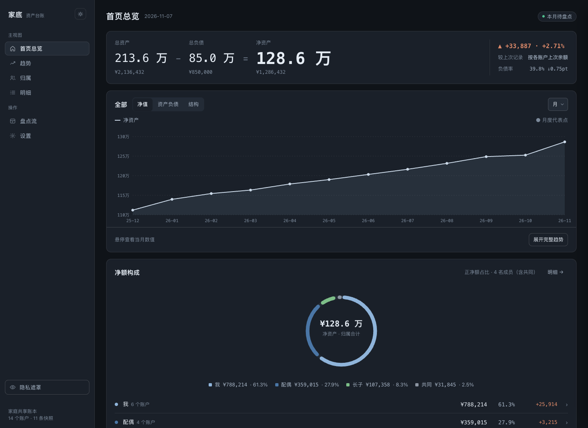
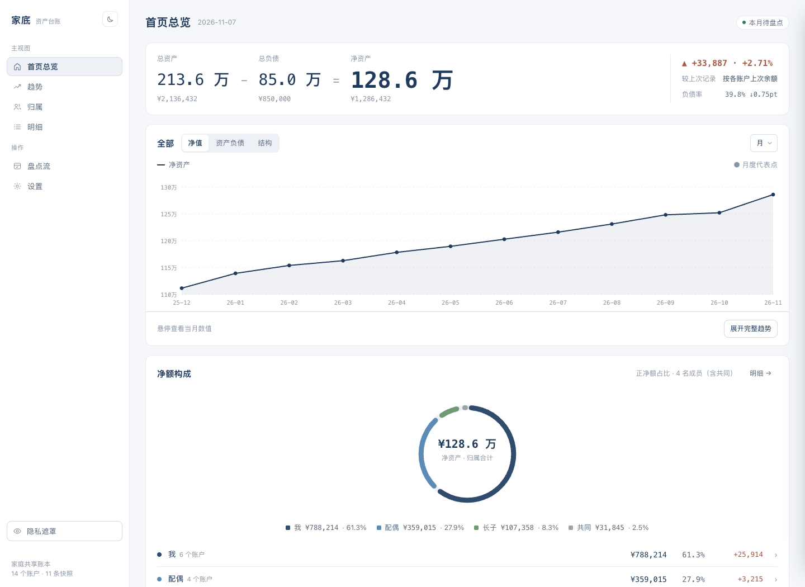
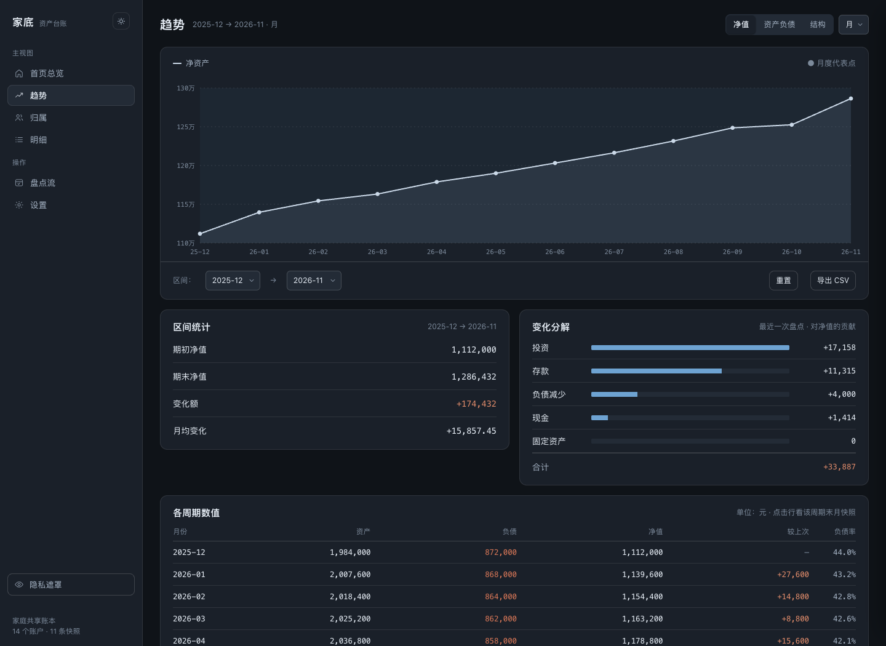
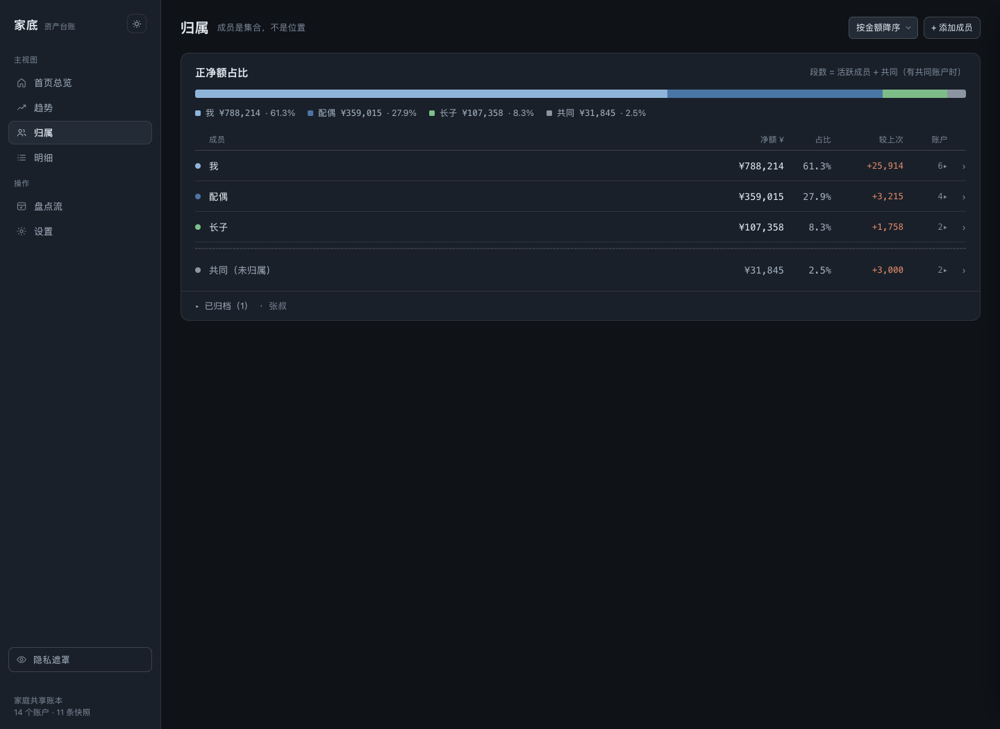
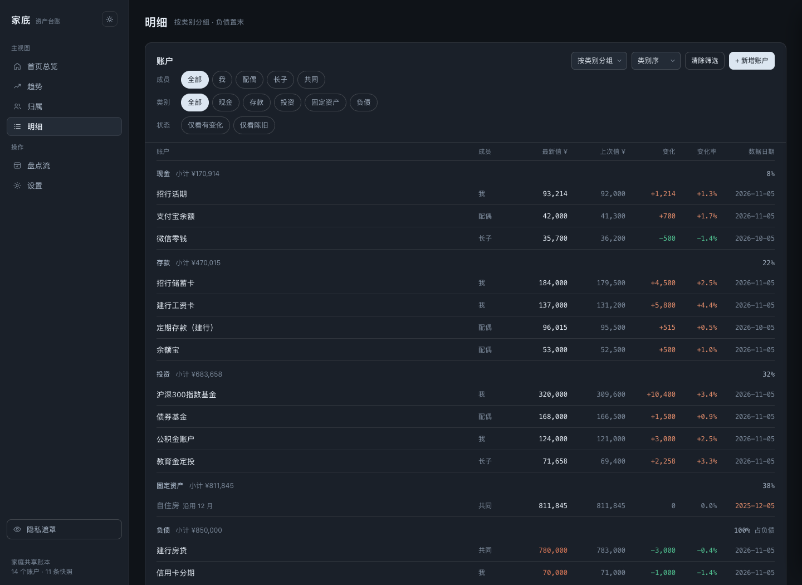
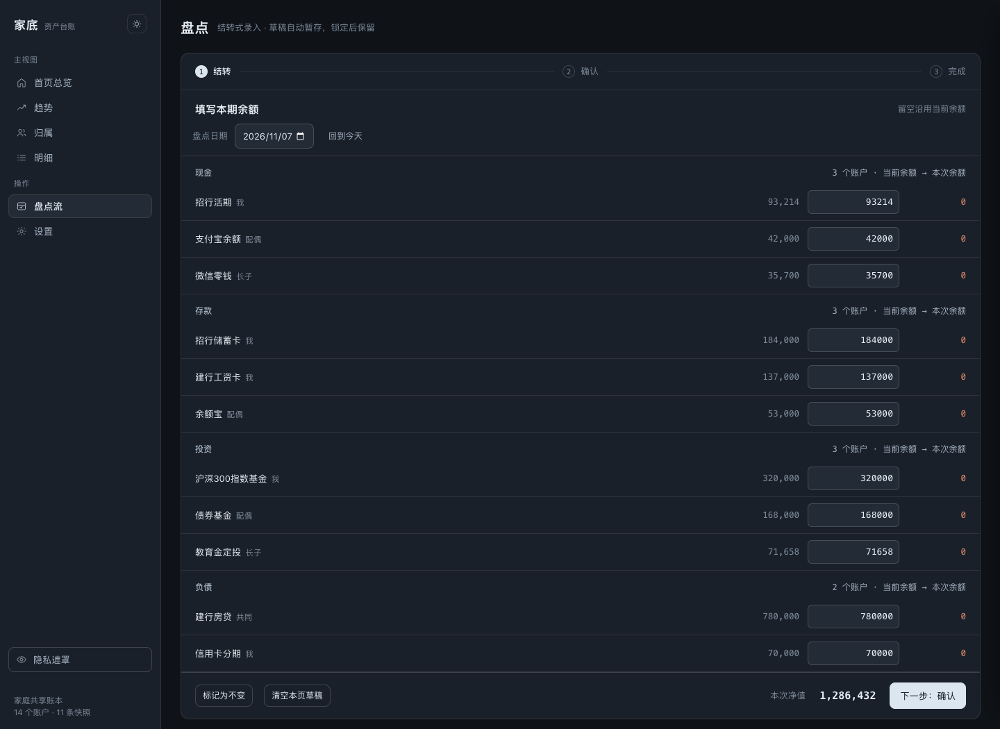
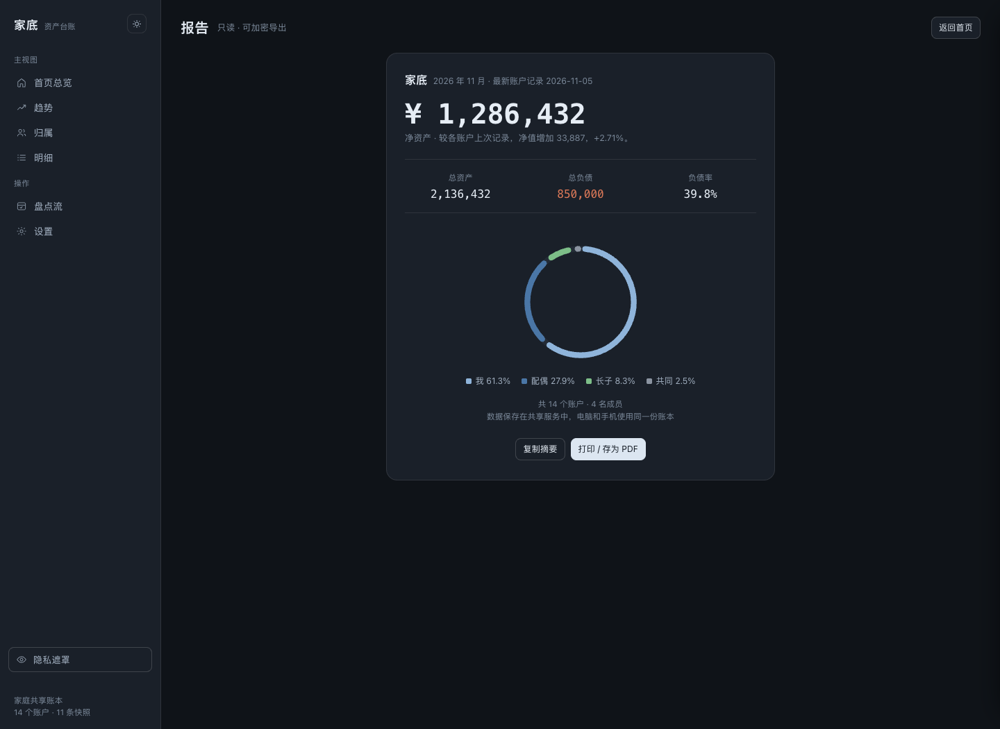
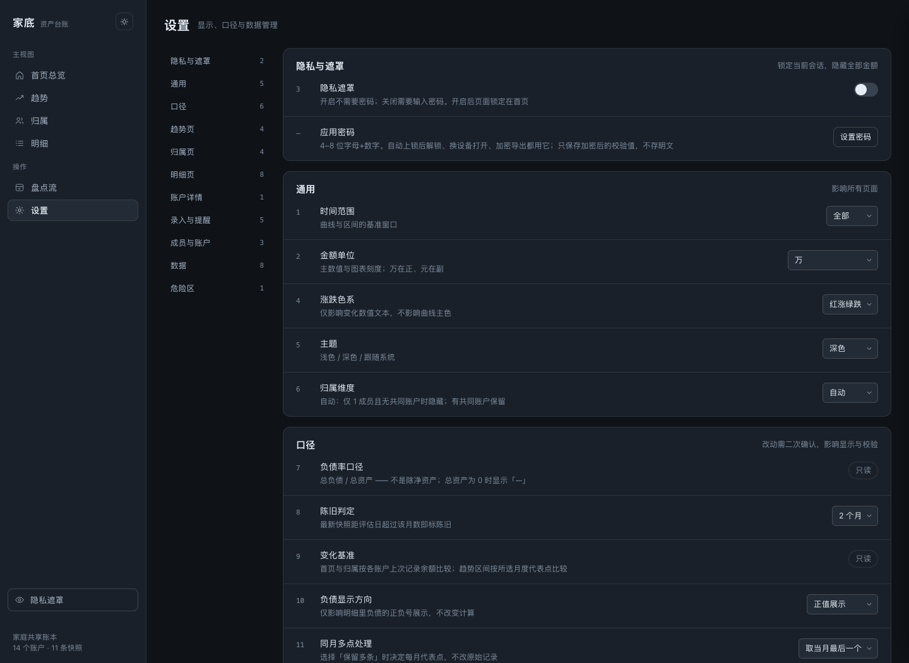
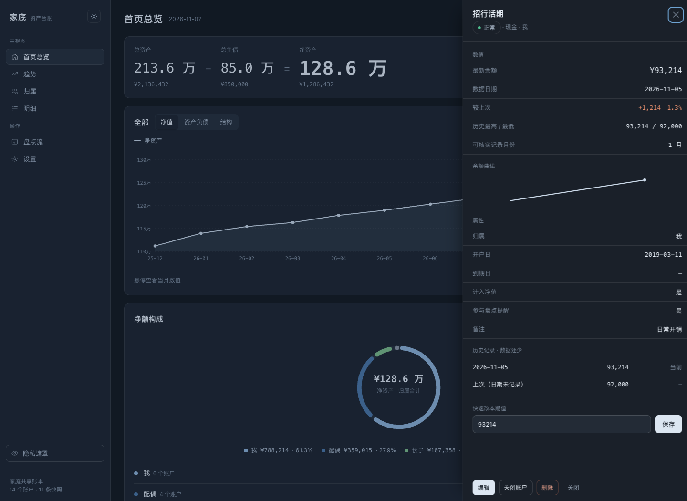
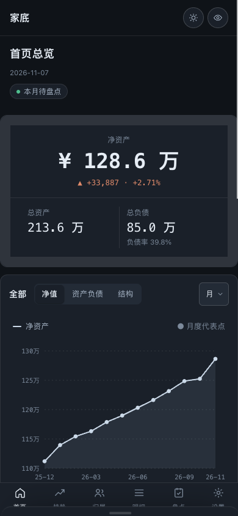

# 家底 · 家庭共享资产台账

[](LICENSE)
[](https://nodejs.org/)

不记流水、不做预算、不连银行。家底只做一件事：按固定周期盘点家庭资金，把「这个月家里有多少钱」记录清楚，然后直观地看到它怎么涨。

**版本 0.5.3**：电脑和手机访问同一服务，共用一份账户、成员、余额历史与月度快照。资产数据保存在服务端，各设备浏览器不再各自存一份账本。

- 源码仓库：<https://github.com/Sunanang/jiadi>
- 问题与建议：<https://github.com/Sunanang/jiadi/issues>
- 许可证：[MIT](LICENSE)

**零依赖、零构建、单文件前端**。全本地存储，不联网、不上报、不需要任何账号。

## 界面

下图全部来自 `jiadi-ui.html` 内置的 SEED 演示数据，不是任何人的真实账本。

| 首页 · 深色 | 首页 · 浅色 | 趋势 |
| --- | --- | --- |
|  |  |  |

| 按人归属 | 按类明细 | 盘点流 |
| --- | --- | --- |
|  |  |  |

| 只读报告 | 设置 | 账户抽屉 |
| --- | --- | --- |
|  |  |  |

手机 390px：

截图由 `npm run shots` 重新生成（无头 Chrome + 演示数据，不接触真实账本）。

## 环境

- Node.js 22+
- 无第三方 npm 依赖，无构建步骤
- 约定验收环境见下方「支持范围」

## 启动

```bash
npm start
```

电脑打开 `http://localhost:8080`。手机与其他电脑访问 `http://<运行服务的主机局域网 IP>:8080`。服务需保持运行。首次访问设置账本密码；其他设备使用同一密码登录。

也可用 Docker Compose：

```bash
docker compose up -d --build
```

Docker 使用持久化卷 `jiadi-data`。升级时保留该卷；删除卷会删除服务端数据。

| 环境变量 | 默认 | 用途 |
| --- | --- | --- |
| `PORT` | `8080` | 服务端口 |
| `HOST` | `0.0.0.0` | 监听地址 |
| `JIADI_DATA_DIR` | 项目下 `data/` | 账本数据目录 |
| `JIADI_SECURE_COOKIE` | 未启用 | 经 HTTPS 反向代理时设为 `1` |

部署在家庭网络内。远程访问请使用 HTTPS 或已有私有网络入口。反向代理需保留 Host，并从站点根路径提供本应用。

## 共享与冲突

- 唯一账本文件：`data/ledger.json`（账户、成员、归档、历史、月度快照、操作日志、密码哈希）。
- 每次保存核对服务端版本；另一设备已更新时，旧页面保存会被拒绝。
- 页面约每 5 秒检查更新，回到前台时也会检查；有未提交输入时保留输入并提示刷新。
- 保存失败回滚界面。若响应中断、无法确认是否落盘，须先刷新核对。
- 浏览器仅保存主题、显示偏好、备份提醒日期和引导状态。
- 所有设备应访问同一套服务；不要为每台设备各启一个进程或使用不同数据目录。

服务端写入采用临时文件、同步落盘和原子替换。数据目录的 `server.lock` 阻止多进程同时写同一文件。异常断电留下锁文件时，确认无账本服务进程后再移除该锁；不要删除 `ledger.json`。

## 密码与加密备份

账本登录、遮罩解锁、修改密码和导出共用一个密码（4–8 位，含字母和数字）。服务端只保存加盐哈希。

- **JSON 备份**：设置 → 数据 → 导出 JSON，下载 `.encrypted.json`（AES-256-GCM）。
- **CSV / 日志 / 自检 / HTML 报告**：导出前同样验密并加密。
- **恢复**：导入 / 解密选择加密 JSON，验密后确认覆盖共享账本。错误密码、损坏文件或取消不会覆盖。
- **解密 CSV / 报告**：同一入口解密后下载明文，不改账本。
- **改密**：验证旧密码后设置新密码；其他设备会话失效。旧备份仍用导出时的旧密码。
- **退出登录**：顶部可结束本机会话；服务重启后需重新登录。

服务端账本文件本身未做静态加密。没有自动备份、云端副本或后台推送。

## 从旧版迁移

旧版浏览器数据不会自动覆盖服务端账本，也不会被删除。

1. 若曾直接双击旧版 `jiadi-ui.html`：升级后仍双击同一文件，可下载旧账本加密迁移备份。
2. 启动共享服务，首次设置账本密码（可沿用旧密码）。
3. 登录后从「导入 / 解密」恢复迁移文件。普通 JSON 备份也可导入。

`home-ledger.html` 与 `home-ledger.glass-v1.html` 为早期参考稿，不是共享版入口。

## 支持范围

| 类别 | 约定支持 | 说明 |
| --- | --- | --- |
| 桌面浏览器 | Chrome 最新稳定版、Safari 最新稳定版 | 主功能与布局 |
| 手机浏览器 | iOS Safari、Android Chrome | 经局域网访问同一服务；宽度约 390px 布局 |
| 运行时 | Node.js 22+，或 Docker（`compose.yaml`） | 需常驻一台主机 |
| 不在范围 | Firefox 专项、打印服务、公网裸 HTTP、多账本多租户 | 未承诺 |

## 飞牛 NAS（FPK 内置微应用）

**不占用独立端口。** 经飞牛统一网关 `/app/jiadi` 打开，使用 **飞牛 NAS 统一登录**（`X-Trim-*`）。日常进入账本不再要求二次登录；首次进入只需设置一次「备份与遮罩密码」。

前置：应用中心已安装 **Node.js v22**。

**直接下载安装**：从 [Releases](https://github.com/Sunanang/jiadi/releases/latest) 取 `jiadi-<版本>-fnos-all.fpk`，在应用中心「手动安装」。

**自己打包**：

```bash
npm run pack:fpk
```

产物：`dist/jiadi-<版本>-fnos-all.fpk`（版本取自 `package.json`）。在应用中心「手动安装」。若已装旧的端口版，请先在应用中心卸载（保留数据），再安装新包：

```bash
trim-cli --profile home --host <NAS> app install-fpk dist/jiadi-<版本>-fnos-all.fpk \
  --volume-id <卷ID> --custom-parameters '[]' --yes
```

打开方式：飞牛桌面 / 应用中心点「家底」（iframe 网关）。手机请通过已登录的飞牛网页或客户端进入同一应用，不要再使用 `:端口` 直连。

账本数据在应用数据目录。源码包结构见 `fnos/`。本地开发仍可用 `npm start`（独立端口 + 账本密码登录）。

## 验证

```bash
npm test
npm run test:browser
```

- `npm test`：服务端临时磁盘、接口、并发版本、会话、密码与加密恢复（无需监听固定端口）。
- `npm run test:browser`：隔离 Chrome 配置下的页面回归与桌面 / 390px 截图（写入 `audit/`）。可用环境变量 `CHROME_PATH` 指定浏览器可执行文件。
- 可选：`node tests/standalone.mjs`、`node tests/shared-browser.mjs` 生成可在浏览器打开的隔离检查页。
- 通用 zip：`npm run pack:zip` → `dist/jiadi-v<版本>.zip`。

验收结论与边界见 [验收记录](docs/ACCEPTANCE.md)。

部署到自家飞牛后可跑一次线上自检（脚本参数见文件头注释，需本地有 ssh 别名）：

```bash
JIADI_SSH_HOST=<NAS> JIADI_NAS_URL=http://<NAS>:<端口>/app/jiadi bash verify.sh
```

## 开源说明

- **许可证**：MIT，可自由使用、修改、分发，保留版权声明即可。
- **贡献**：欢迎 issue 与 PR。改动前先跑 `npm test`；涉及前端交互的改动请补浏览器回归。
- **安全边界**：服务设计为家庭内网使用。请勿直接暴露到公网裸 HTTP；需要远程访问时用 HTTPS 反向代理或私有网络入口（如 WireGuard / Tailscale）。
- **数据责任**：账本只存在你自己的机器上，没有云端副本。请自行定期导出加密备份，并放在服务之外。

## 目录结构

```
server.mjs          Node 22 服务：网关 socket / 统一登录 / 账本读写 / 密码门禁 / 草稿暂存
jiadi-ui.html       单文件前端（逻辑在 <script id="ledgerApp"> 内，由 shared-client.js 注入执行）
shared-client.js    会话、密码页、空闲锁、轮询、草稿存取
ledger-domain.mjs   normalizeData 严格校验
fnos/               飞牛 OS 打包骨架（manifest / cmd / wizard / config）
scripts/            打包脚本（pack.sh / build-fpk.sh）
tests/ test/        服务端、浏览器回归、畸形输入矩阵、验收探针
verify.sh           部署后线上自检
人工验收清单.md      人工发版验收步骤
docs/               验收记录与边界
```
